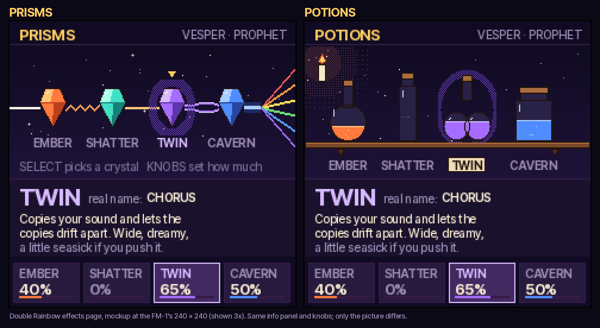

# Double Rainbow

Double Rainbow is a firmware for the M-VAVE FM-1, built on [Melodee](https://github.com/keremimo/melodee). It turns the
FM-1 into a game-like instrument for ages 10 to 14 and up, and for grown-ups who like the same things they do. Think of the
taste of a good YA novel: a little dark, a little funny, never babyish.

It is the older sibling of [Rainbow mode](https://github.com/joshbartlettband-web/felucca-rainbow), the toy we made for a
four-year-old on Felucca. Rainbow mode was bright and almost wordless. Double Rainbow is eerie and cool without being
grim. It uses more text, and its sound is much richer, because Melodee has more engines and more effects.

This file is the plan. Nothing in it is built yet. Items marked **(open)** still need a decision.

## The core idea

- **Fun first.** Every feature has to be fun to touch before it teaches anything.
- **Learn the instrument by playing it.** Each character is built on one of Melodee's engines. Each one teaches you how
  that engine makes sound.
- **A path into the full synth.** Double Rainbow is the front door. Melodee, with all of its depth, is one button combo
  away.

## Theme: Rainbow after dark

A rainbow at night is real. It is called a moonbow. Double Rainbow lives in that world: night skies, aurora, glowing
deep-sea creatures, lantern light and a slightly spooky night carnival.

- Palette: deep indigo, plum, ember orange and bioluminescent teal, with warm accents.
- Pixel art in the Rainbow style: vector first, snapped to pixels, dark outlines. All characters are new drawings.
- The tone is eerie and cool, never grim. Nothing gory, nothing that would scare a ten-year-old for real.

**Built so far:**

- **The startup screen** (`firmware/src/dr.c`, `dr_splash`): a double moonbow over dark hills with fireflies, and the
  title. It is drawn from code, not a stored picture, and true to the real thing: the secondary bow's colors run the other
  way, the sky is brighter inside the primary bow and darker between the two (Alexander's band), and there is no moon in
  the sky (a moonbow faces away from the moon).
- **MOON**, a palette for Melodee's own screens (`tools/gen_ui_palettes.py`): deep indigo, warm white text, gold values,
  teal for the active thing. It is the default on a fresh install; a palette already chosen in the menu (COLOR) is kept.
  It passes Melodee's contrast checks, and Melodee's UI tests (every screen in every palette) run on every push.

## The world: the Keeper (agreed)

Somewhere in the hills lives **the Keeper**, who catches sounds in glass jars and keeps them on shelves in a
room with no light. One night **Squall**, a small storm, broke out of jar twelve. The jar shattered, and **Shard** is
its glass, which caught the moonlight on the way out (the rainbow in his chest). **Vesper** came to the light, as
moths do, and has followed the two of them ever since. The double moonbow's second, reversed arc is where escaped
sounds go: Squall took it with him.

**The Line (agreed).** The hills' edge is the Line, drawn by whatever sound is loose in the hills: when nothing
sounds it lies flat, and every note redraws it (the horizon on the character screen does exactly this). The
Keeper keeps sounds in jars to keep the Line still, and every sound let out makes it move again. The room is an
arcane machine more than a cupboard: tuned glass jars wired in copper, numbered like channels. The ledger is written
in traces, not words, and Hush is the one who reads it. Each character is a way the Line moves: Shard splits it into
colors, Tock counts it, Mote is the dust in it, Squall keeps it from lying flat, Murk bends it, Wick hums one steady
line, Tumbler tunes the jars that hold it, Glint snips bits off it, Hermit's horn throws it to the hilltops, Bog draws
the same four shapes on it, Vesper follows its glow, Burrow digs under it, Pip taps the jars to hear it, and Echo's
jar holds a copy of someone else's. Code carries it, not new paintings: every glow flickers with the Line, and
Hush's locket shows it live.

- **Every new character is another jar.** Unlocking one frees it, and each remembers something about the Keeper.
- **The codex is the Keeper's ledger**, a page per character in the Keeper's own voice (cryptic, possessive,
  never cruel), then the engine's real story, then something to try.
- **The mystery that pulls you along:** who the Keeper is, and why the sounds are kept. Eerie, never grim.
- Keep it consistent: every new character's ledger page should connect to at least one other character, a jar
  number, or the moonbow.

Built: the ledger is page 1 of each character's codex (`firmware/src/dr.c` DR_CODEX).

## Starting up and getting to Melodee

- The FM-1 starts in Double Rainbow every time it powers on.
- HOME and SAVE held together for 3 seconds take you to the full Melodee (built; a countdown shows on the screen).
  Double Rainbow saves nothing, so playing in it cannot overwrite your own work: Melodee starts as it would have
  (track 1's own sound, then your BOOT project or template).
- **(open)** Whether Double Rainbow should remember a choice to start in Melodee instead.

## The cast

Characters with attitude, each built on one engine. The engine families work like factions, so getting to know a
character means getting to know an engine.

| Engine | Its characters feel | What they teach |
| --- | --- | --- |
| PROPHET | big, warm and dramatic | two oscillators, a four-pole filter, envelopes, poly-mod (the 1978 Prophet-5) |
| FM6 | glassy, metallic, bell-like | frequency modulation: operators, ratios and algorithms (the DX7) |
| CZ-1 | strange and digital | phase distortion with eight-step envelopes (Casio's CZ) |
| PHASE | sharp and shifting | phase distortion in a simpler form |
| LOFI | 8-bit gremlins | pulse waves, noise and wave RAM, like old game consoles |
| VOICE | singers and choirs | formants: how vowels are made |
| NOISE | weather, machines and ghosts | noise colors, crackle and metallic tones |
| DRUM | the rhythm section | the TR-808's circuits |

Each character has a name and one line of personality, a codex entry (how its engine works, a bit of history and
something to try), four named knobs that each move up to three real settings, and its own sound.

**Built so far: the first three** (`firmware/src/dr.c`). Art: Gemini concepts (`art/gemini/`, $0.60 for nine),
made into 4-bit sprites by `tools/art/procchar.py` (`art/sprites/`), packed into the firmware by
`tools/art/gen_dr_art.py` (about 9.4 KB for the three).

| Character | Engine | Line | Knobs (what they move) |
| --- | --- | --- | --- |
| VESPER, a moth in a velvet cape | PROPHET: our own program, saw + pulse through the SSI filter | Every note is her final scene. | GLOW (cutoff), BITE (resonance, filter envelope), BLOOM (attack, release), DRIFT (vintage, vibrato, detune) |
| SHARD, a glass fox with a rainbow inside | FM6: Melodee's own BELL voice | Sharp, clear, honest to a fault. | SHINE (modulator level), METAL (modulator ratio), RING (modulator decay), TWIST (detune) |
| SQUALL, a sulking storm cloud with glowing eyes | NOISE: the META source, an airy hiss repeated at the note's pitch | Escaped from a jar. Still mad. | GUST (LFO swells), HOWL (sequence length: hiss to howl), RUMBLE (darker, browner), SPARK (distortion) |

Squall first used filtered white noise, and on the FM-1 its pitch did not come through (measured: 20 % of its energy
on the note's harmonics, however narrow the filter). META carries the tune (79 %) and still sounds like weather.

Art fixes are made in code where they can be (`tools/art/make_sprites.sh` rebuilds every sprite): Squall's eyes and
bolt are recoloured yellow (`tools/art/fix_squall.py`). Shard's chest could not be fixed that way (the first picture's
chest was a solid block of rainbow, with no glass under it to work from), so he was redrawn by Gemini with the light
faint inside his glass (`art/gemini/shard_d.jpg`). **Shard's light** (`firmware/src/dr.c`, built): each note sends a
band of spectrum across his chest, half the glass's own colour, then he is clear glass again. It is the first of
the code animations on top of the painted sprites.

**Animations (built), all from code, no stored frames** (`firmware/src/dr.c`; `docs/mockups/animations.gif`):

- **The glow.** Each sprite marks a few of its colours (`tools/art/gen_dr_art.py`: Vesper's eyes, Squall's bolt,
  Wick's flame, Tock's clock face, Mote's eyes, Murk's bell, Bog's throat, Hush's ink, Tumbler's eyes, Glint's
  trinkets, Hermit's horn). They brighten with the sound's level and breathe slowly when it is quiet. Only their
  rows are redrawn, at most 15 times a second; it costs a few bytes of RAM and no pictures.
- **The float.** Squall and Murk rise and fall 4 px, about every 3 s.
- **The blink.** Every few seconds the eyes shut for a moment, now and then twice. The eye boxes are marked by hand
  (`tools/art/dr_eyes.py`, which also previews every face open and shut); the shut eyes are made at build time and
  stored as small patches (under 1 KB for all twelve). Tock has a clock for an eye and does not blink.
- **The squash.** Each note presses the character down 4 px, top first, and it springs back over 0.2 s (not Tock,
  a machine).
- **Shard's light** sweeps his chest on each note.

Every knob was checked to change the sound (brightness, level, swell, tail or pitch, measured on renders), and the
three were leveled by measured loudness (BS.1770, within 1 dB on a test phrase).

**Built: the next four** (lore agreed; concepts `art/gemini/*_a.jpg`, Mote's marble redrawn as a jar stopper by
`tools/art/fix_mote.py`). CZ-1 plays Casio's own tone data and has no settings to turn, so Murk is on PHASE, the same
phase distortion with real controls; her codex page tells the CZ's story.

| Character | Engine | Line | Knobs (what they move) | Ledger hook |
| --- | --- | --- | --- | --- |
| WICK, a candle who sings vowels | VOICE: CHOIR AAH, quicker and breathier | Sings when nervous. So, always. | VOWEL (AH to OO), TALK (moves between two vowels), BREATH, TREMBLE (vibrato and a shake) | The night-light. She saw who broke jar twelve. |
| TOCK, a clockwork beetle | DRUM: the 808 kit (the chip names the drum struck) | Keeps time. Keeps grudges. | TUNE, BOOM (decay), SNAP (snap, tone), GRIT (drive) | The clock. He has counted every night since jar one. |
| MOTE, an 8-bit gremlin of jar dust | LOFI: PULSE LD | Small. Loud. Probably your fault. | DUTY, SHAPE (pulse, triangle, saw), ZAP (pitch sweep), CHIRP (arpeggio) | Steals the jars' glass stoppers; that is why some jars hum. |
| MURK, a deep-sea jellyfish | PHASE: STRING, slower | Bends the light. Bends the rules. | BEND (DCW), SWELL (DCW envelope), TIDE (the eight waves), DEPTH (sub) | Jar one, let go on purpose. She knows what is in jar thirteen. |

**Built: the last five** (concepts `art/gemini/*_a.jpg`), for twelve in all:

| Character | Engine | Line | Knobs (what they move) | Ledger hook |
| --- | --- | --- | --- | --- |
| BOG, a swamp toad | ANALOG: ACID (the TB-303 squelch) | Squelch is a love language. | SQUISH (cutoff), GOO (resonance), GULP (envelope amount, decay: the squelch, slowed 30 % on Josh's ear), GRIT (drive) | Jar four, the reed jar: the same four notes forever. |
| HUSH, a barn owl who listens (a grooved listening face, a scope locket that shows the Line live) | ANALOG: PWM STR (a string machine) | Writes everything down. Says nothing. | DUSK, FLUTTER (detune), HOLLOW (oscillator mix), WINGS (attack, release) | She reads the Line like a page, and has read the torn-out pages. |
| TUMBLER, a living brass key | FM6: DX TINE (the DX7 electric piano) | Opens anything. Asks no one. | BARK (mod level), CLANG (mod ratio), RING (mod decay), SHEEN (chorus) | The key to the room: the door has not locked since. |
| GLINT, a magpie | CZ-1: Casio's own 64 tones | Takes the best part of everything. | TONE (A-1 .. H-8, a tone a detent, its name on the line), SHINE (chorus), GRIT (dist), SPACE (reverb) | Another collector in the hills. |
| HERMIT, a hermit crab in a horn | PROPHET: Sequential's Iconic Brass | Lives in a horn. Plays it, too. | BLARE (cutoff), BITE (env amount), SWELL (attack), GROWL (resonance, vintage); they start where the program has them | Jar nine: something moved in. |

All twelve are leveled within 1.9 dB by measured loudness (the drums by their own measure), and each new character
has a knob checked in `web/emu/dr_test.mjs` to move its setting and its sound. The art takes about 33 KB for twelve.

**Built: three more, for fifteen** (concepts `art/gemini/burrow_a.jpg`, `pip_a.jpg`, `echo_a.jpg`; screens
`docs/mockups/new_three_screens.png`):

| Character | Engine | Line | Knobs (what they move) | Ledger hook |
| --- | --- | --- | --- | --- |
| BURROW, a badger with a lantern | ANALOG: SUB BASS on a saw, mono | Digs where the low notes go. | DEEP (darker), THUMP (filter kick), GROWL (drive), DIG (a slide between held notes) | The low notes sink under the Line; he digs them back up. |
| PIP, a woodpecker with mallets | FM6: MARIMBA (Melodee's own; the DX7's rang out too fast) | Taps everything twice. | KNOCK (mallet: mod level), WOOD (mod ratio), RING (mod decay), ROOM (reverb) | Taps every jar to hear if it is full. He tapped jar thirteen. |
| ECHO, the fog from jar thirteen | VOICE: WHISPER with more buzz | Says what you said. Later. | VOWEL, WHISPER (more breath), ECHO (each note back 1 to 3 times, an eighth apart, softer), FADE (release) | Jar thirteen was full and sealed when the Keeper found it. |

Melodee has no delay (0.12 took it out for memory), so Echo's ECHO is code: each new note is sent again an eighth
note later at the tempo, softer each time (`dr_frame`, through Double Rainbow's note player), in SOLO, WEAVE and
CAST only. Pip is leveled as a struck sound, by its own measure like Tock's drums: a marimba dies away, so its
average is lower at the same peak. **Josh to listen:** Pip's level against the others, and Echo's repeats.

**Built: five more, for twenty** (concepts `art/gemini/fork_a.jpg`, `ants_b.jpg`, `rabbit_a.jpg`, `top_a.jpg`,
`cairn_a.jpg`, made at 512 px to save money; screens `docs/mockups/five_screens.png`). The ants were first drawn as a
choir of seven (`ants_a.jpg`), too small to read at this size, so they were redrawn as three.

| Character | Engine | Line | Knobs (what they move) | Ledger hook |
| --- | --- | --- | --- | --- |
| FORK, a little robotic tuning fork | FM6: TUBULAR, a near-pure ring | A, and nothing else. | PURITY (fewer harmonics), RING (release), DRIFT (detune: two forks beat), CLANG (mod ratio) | The reference: the zero the Line is measured from. |
| ANTS, a choir of three | ANALOG: STRINGS, a section of many that nearly agree | We are one. We are many. | COLONY (chorus), SWARM (detune spread), MARCH (vibrato), HUM (cutoff) | They carry crumbs of sound along the Line. |
| RABBIT, a golden rabbit with a moon charm | FM6: GLASS PAD, a warm bed with a thin bell of metal | Warm. Mostly. | WARM (mod ratio), SHEEN (mod level), BLOOM (attack, release), MOON (reverb) | Waits where the moonbow meets the Line. |
| TOP, an unceasing spinning top | PHASE: ORGAN, full sustain and a long release | Cannot stop. Tried. | SPIN (wobble speed), LEAN (wobble depth), WHIRR (DCW), REV (attack) | The Keeper spun it once, to see how long the Line would stay alive. |
| CAIRN, a creature of stacked pebbles | NOISE: DUST through a resonant filter that follows the key: a stone struck, with a core on track 3 (FM6 KALIMBA) so every note has a pitch | Balanced. Don't breathe. | CLACK (filter pitch), SCATTER (density), ROLL (decay), CORE (the kalimba's level) | Piled over jar seven; the stones stood up and keep watch. |

Pip, Tock and Cairn are leveled by their own measure (struck sounds die away, so their average sits lower at the
same peak), within 6 dB of the others; the other sixteen are within 3 dB. **Josh to listen:** Cairn's level and
whether the clacks sound like stones, Top's wobble, the Rabbit's metal against its warmth, Fork's DRIFT with a chord,
and the Ants' COLONY and SWARM.

**Built: four more, for twenty-four** (concepts `art/gemini/stray_a.jpg`, `tuppence_a.jpg`, `gloam_a.jpg`,
`tinker_a.jpg`, at 512 px; screens `docs/mockups/four_screens.png`). The fire that never burns out was dropped (too
close to Wick), and the pocket knife became a multi-tool with no blade out.

| Character | Engine | Line | Knobs (what they move) | Ledger hook |
| --- | --- | --- | --- | --- |
| STRAY, a lost action figure | FM6: SYNC LEAD, a bright lead | Looking for where he goes. | HEROIC (mod level), PLASTIC (mod ratio), CAPE (vibrato), SEARCH (a slide up into each note) | Not from the shelves: he walked in along the Line. |
| TUPPENCE, a mouse with a dollhouse cello | ANALOG: SAW LEAD with a slow, soft start: a bowed string | Plays what she can reach. | BOW (attack), SCRAPE (resonance), SWAY (vibrato), BODY (cutoff) | The dollhouse is a model of the Keeper's room, jar for jar. |
| GLOAM, the Keeper's living logbook | FM6: BELLS, a tower's bells | The Keeper's log. It writes back. | CREAK (a slow wobble), TOLL (mod level), TOWER (detune), MIST (reverb) | The Keeper logged every jar in it, until a castle grew out of the pages in the Line's ink and rang its bells at every word. Repainted after the pale drawing (`gloam_a.jpg`) looked washed out on the dark screen; the options are `docs/mockups/gloam_options.png`, the one used is `gloam_g.jpg`. |
| TINKER, a multi-tool | FM6: CLAVINET, a click then a ring | Always a tool for it. | CLICK (mod level), TOOLS (mod ratio), SNAP (mod decay), SPRING (release) | He cut the seals off the jars, and remembers every one. |

Gloam is on BELLS because the organ patches have no audible modulator, so a TOLL knob did nothing on them (Fork,
Pip, Rabbit and Stray do have one). Stray has no blink: his face is too small at this size to show it. Tinker joins
Tock, Pip and Cairn as leveled by his own measure. **Josh to listen:** Stray's lead against the others, Tuppence's
bow (BOW up, slow notes), Gloam's bells in a low register, Tinker's clicks.

Watch for accidental look-alikes of known characters (a lesson from Rainbow mode). Change colors and features until each
one reads as its own thing.

## The Double Rainbow screen (built)

The FM-1 starts in Double Rainbow every time it powers on.

| Control | What it does |
| --- | --- |
| Keys | Play the character (in SCRY and TRACE too). The chord or note just played shows at the top left (Melodee's own recognizer), and the horizon traces the live waveform in the character's glow (amber, Shard's drifting bands, lightning yellow); silent, it lies flat on the hill. It is measured against MASTER, so the same note draws the same wave at any volume. |
| PRESETS | The next or the previous character. In the codex: its pages. |
| KNOB 1 to 4 | The character's four knobs, 2 % a detent. |
| ALGORITHM | How the keys play: SOLO, WEAVE, CAST, SCRY, TRACE (below). |
| SELECT | The key for WEAVE, CAST and SCRY, a fifth at a time. In TRACE: the song. |
| PLAY | SOLO, WEAVE, CAST: the character's beat, on and off (below). SCRY: hear the question again. TRACE: hear the song (PLAY or any key stops it). |
| GLO held | PRESETS jumps five characters a detent (twenty is a long way round one at a time). |
| SEQ | The next beat (it starts if it was off). Held, with SELECT: the tempo, 4 BPM a detent. |
| EDIT held | The cards show what each knob really moves. |
| SCL | The codex: the Keeper's ledger, the engine's story, then something to try (PRESETS turns the pages). SCL again closes it. |
| OCT- / OCT+ | The keys an octave down or up (two each way). In SCRY: the drill. In TRACE: the song. |
| HOME + SAVE held 3 s | The full Melodee, as it would have started (track 1 gets its own sound back; nothing is saved). Double Rainbow comes back at the next power-on. |

Tests: `web/emu/dr_test.mjs` drives it like a player on the browser build, on every push (the cast and its engines,
loudness, the knobs, EDIT, the codex, OCT, the LEDs, all five modes, the HOME + SAVE countdown, and that every text
fits its room).

## Ways to play (the spellbook modes)

Turned on ALGORITHM, as Rainbow mode's modes were. The names are spells. Each mode's codex entry says what musicians
call it.

| Mode | What it does | Grew from |
| --- | --- | --- |
| **SOLO** (built) | Each key plays its note. | Rainbow's 1 FRIEND |
| **WEAVE** (built) | Strum. A black key picks a chord and plays its root low; the white keys strum its notes upward from C3, like an Omnichord. | Rainbow's STRUM (u/veecheech) |
| **CAST** (built) | Chords under a tune. A black key holds its chord (softer) while the white keys play a melody. Jazz players call this comping. The white keys follow the key SELECT picked: each keeps its letter and takes the key signature (in G every F is F#, in F every B is Bb), so the tune stays in key with the chords. | Rainbow's ACCORDION |
| **SCRY** (built) | Ear training. Hear it, then find it on the keys: notes, intervals, chords. The pool grows as you get them right. | Rainbow's GUESS (u/nutty_cartoon) |
| **TRACE** (built) | Learn a song. The next key lights and you play at your own pace. | Rainbow's FOLLOW (u/nutty_cartoon) |

ALGORITHM turns SOLO, WEAVE, CAST, SCRY and TRACE (a line says what the mode does as it changes; a chip at the top right names
it). The black keys' chords, in C major, each the chord of the white key just below it (`firmware/src/seq.c`,
Double Rainbow's spellbook keys):

| Black keys | Chords | Numerals |
| --- | --- | --- |
| Lower row, F#3 .. D#4 | F, G, Am, C, Dm | IV, V, vi, I, ii |
| Upper row, F#4 .. D#5 | Fmaj7, G7, Am7, Cmaj7, Dm7 | IVmaj7, V7, vi7, Imaj7, ii7 |
| Top key, F#5 | Fm, borrowed from C minor (the bittersweet one) | iv |

In WEAVE and CAST the chip names the chord picked and its numeral ("Am vi"); in SOLO it names what was played, as
Melodee's HOME does. A seventh is four notes, so CAST plus one tune note fills the Prophet's five voices.
SELECT changes the key, round the circle of fifths (C G D A E B F# Db Ab Eb Bb F): every chord moves with it, flat
keys are spelled with flats, and the mode chip shows the key ("CAST  Bb").

**SCRY** (`firmware/src/dr.c`). The questions play on the character itself. OCT- / OCT+ picks the drill:

| Drill | The question | The answer | Pool (starts, grows to) |
| --- | --- | --- | --- |
| NOTES | The key's home note (lit), then a mystery note from its scale | That note, in any octave | 2 to 8 (do, sol, mi, re, la, fa, ti, high do) |
| INTERVALS | Two notes, the first lit | The second note, in any octave; the answer names the interval | 2 to 12 (fifth and octave first, tritone last) |
| CHORDS | A chord of the key | The black key that holds it (the black keys play their chords, as in CAST) | 4 to 11 (I IV V vi first) |

Three right in a row adds one more to tell apart ("+1 NEW"). A miss asks again; after two misses the right key
blinks. The chip shows the streak and the best. SELECT moves NOTES and CHORDS to a new key.

**TRACE.** The next key lights and the chip says its name and where you are ("NEXT  A", "NOTE 7 OF 37"). A wrong key
changes nothing, so you go at your own pace. At the end it starts again from the top. PLAY plays the song with the keys
lighting as it goes. The songs are written readably in `tools/gen_dr_songs.py` (the build checks they fit the keys);
14 songs take about 1.3 KB.

## A kid's name (built)

The startup screen can say hello to a kid by name: HELLO, and the name in big letters over the bows (the line on
the character screen says it too). Two ways to set it, both in Rainbow mode as well:

- **On the FM-1:** HOME held, then ALGORITHM opens YOUR NAME. PRESETS picks a letter (a space, then A to Z),
  ALGORITHM the next of ten places, SAVE keeps it, HOME leaves it as it was. The beat stops while it is open
  (Melodee writes settings only while stopped). `docs/mockups/your_name.png`, `docs/mockups/hello_splash.png`.
- **On the website:** the installer has a name box. The name goes over USB to the FM-1 only (the editor's NAME,
  cmd 50: ten letters or spaces, the reply its result and the name kept), never to a server, and the page keeps
  nothing. Typed before installing, it is sent when the install is done; sending it empty clears it.
  `web/test_name_page.py` checks the box against a fake FM-1.

It is kept in eleven spare settings bytes (the retired SLICE engine's favourites row, bytes 20 to 30: ten letters or
spaces and a check byte), the same place and check as Rainbow mode, so an old install keeps all its settings
(`firmware/src/dr_name.c`). `dr_test.mjs` enters a name, powers off and checks the hello. Double Rainbow now runs
Melodee's settings save in its own loop; before, nothing it changed was ever written.

## Beats (built)

After Rainbow mode's: each character has its own beat, played by Melodee's sequencer, with the 808 kit on track 4
and a bass line on track 2 (ANALOG SQR BASS); track 3 rests. PLAY starts and stops it, SEQ goes to the next one, SEQ
held with SELECT sets the tempo (60 to 180), and changing character changes to their beat. The bass is written on C
(roots, fifths and octaves) and moves to the key in SOLO, and to the chord a black key picks in WEAVE and CAST, so it
follows the hand. The character bobs on each beat. SCRY and TRACE stop it, for the ear. Leaving for Melodee puts
tracks 2 to 4 and the tempo back. Each beat sits about 4 dB under its character (`dr_test.mjs` checks the level).

| Character | Beat | BPM | Feel |
| --- | --- | ---: | --- |
| Vesper | VELVET | 84 | a slow, dramatic half time |
| Shard | GLASS | 122 | crisp and clean, rim clicks |
| Squall | STORM | 128 | rolling toms, open hats |
| Wick | JITTERS | 138 | nervous sixteenth hats |
| Tock | CLOCKWORK | 108 | tick, tock: rim and cowbell |
| Mote | ARCADE | 150 | a chip tune's octave bounce |
| Murk | UNDERTOW | 76 | a deep, slow dub |
| Bog | SQUELCH | 124 | four on the floor, for the acid |
| Hush | MOONLIT | 82 | a quiet, nodding night beat |
| Tumbler | LOCKPICK | 104 | funk |
| Glint | SHINY | 118 | disco |
| Hermit | PARADE | 100 | a brass band's street beat |
| Burrow | DEEP DOWN | 86 | a slow, heavy nod |
| Pip | WOODBLOCK | 112 | a clave, tapped |
| Echo | AFTERGLOW | 92 | half time, room for her repeats |
| Fork | A=440 | 100 | a metronome's tick over one long note |
| Ants | PROCESSION | 108 | a steady march of tiny feet |
| Rabbit | MOONRISE | 76 | slow, warm and wide |
| Top | SPINNING | 132 | a round, rolling ride |
| Cairn | STONEFALL | 94 | clacks and knocks |
| Stray | SEARCHING | 104 | steady steps, calling out |
| Tuppence | NIBBLE | 84 | small, soft, a little hurried |
| Gloam | SKETCH | 90 | low and creaking |
| Tinker | FOLD OUT | 116 | snaps and clicks, a tool at a time |

## Cores: a second sound on track 3 (built)

Some characters need a pitched heart under them. Cairn's stones are noise through a filter, so on their own the
notes are hard to hear as notes. A core is a second sound on track 3 that plays every note track 1 plays: the keys,
the arp and SCRY's and TRACE's player (`voice.c` `dr_core`, set by `dr.c` `dr_core_load`). `DR_CORES` in `dr.c`
lists them: the character, the engine, the preset by name and the level. A knob can move the core's level
(`DR_CORE` routes). With a core the beat leaves track 3 playing; without one track 3 is Melodee's own again.
(PHYS, which has a modal kalimba, is retired in this build, so the cores use the live engines.)

Built: Cairn (FM6 KALIMBA, the CORE knob). Ideas for others, to try by ear: Squall with a low SUB BASS, Echo with
a quiet GLASS PAD, Ants with a STRINGS bed. Every core costs voices, so keep them for the characters that need one.

## Songs for TRACE

The melody of a current pop song is copyrighted on its own, separately from any recording. Shipping one in a public
firmware could get the repository taken down. So there are two routes.

**1. Public-domain tunes people will recognize.** We use the old melody, never a modern arrangement. Built (the
opening phrase or two of each, to fit the keys at OCT 0):

- Korobeiniki (the Tetris theme, a Russian folk song)
- Für Elise (Beethoven)
- In the Hall of the Mountain King and Morning Mood (Grieg)
- Toccata in D minor (attributed to Bach)
- Dies Irae (a medieval chant that film composers use for doom)
- Greensleeves (English, 1500s)
- Carol of the Bells (Leontovych, 1914; the melody, not the later English lyrics)
- Ode to Joy (Beethoven)
- Canon in D (Pachelbel)
- Eine kleine Nachtmusik and the Turkish March (Mozart)
- Gymnopédie No. 1 (Satie; it sounds like lofi)
- Habanera (Bizet, from Carmen)

Still to add: Wellerman, Danse Macabre, Night on Bald Mountain, Funeral March of a Marionette (Hitchcock's TV theme),
Mars from The Planets (check its US status first), Moonlight Sonata, Clair de lune, House of the Rising Sun.
Each song should get a codex note on where you have heard it.

**2. Bring your own songs.** Load any melody for your own use from the web editor or a MIDI file. We never ship it, and
it never leaves your FM-1. That is how people get today's songs into TRACE.

**3. Our own riffs.** Short riffs we write in a genre's style (a synthwave arpeggio, a metal riff, lofi chords). They
teach the genre and belong to us.

## Effects: Prisms

**Decided:** effects are crystals, not pedals (most players this age have never seen a pedalboard). Your sound is a beam
of light that crosses each crystal in order and leaves the last one as a rainbow. Each crystal changes the beam the way
its effect changes the sound, so the screen shows the whole chain at a glance, including what is off, and quietly
teaches that effects run in order. Potions (bottles on a candlelit shelf) was the runner-up.

Mockups at the FM-1's 240 x 240 are in `docs/mockups/` (`effects_mockup.py` redraws them). The layout: the beam and its
crystals on top, an info panel with the crystal's spell name, its **real name** and a short plain description, and four
knob cards for how much of each crystal.

| Crystal | Real effect | What the beam does |
| --- | --- | --- |
| EMBER | Distortion | turns jagged and red-hot |
| SHATTER | SLICER (gate and stutter) | breaks into dashes |
| TWIN | Chorus | splits into two drifting beams |
| CAVERN / SPRING | Reverb (room / spring) | spreads into a soft glow |
| ECHO | Repeat | leaves fading copies |
| REWIND | Reverse | flows backward |
| SWEEP | Filter sweep | its color slides across the spectrum |
| SLUMBER | Tape stop | slows and droops |
| FROST | Freeze | stops and ices over |
| SHIMMER | Harmonizer with shimmer | splits an octave up, sparkling |

- SELECT picks a crystal; KNOB 1 to 4 set how much of each. Holding a button could open a crystal's other settings
  (Melodee's chorus and reverb have a few more than an amount). **(open)**
- On the device the beam shimmers and the crystals glow with their amounts.
- Melodee 0.12 removed the shared delay to free memory for recording. ECHO has to come from repeat, or we spend memory
  putting a small delay back. **(open)**

## More to build

- **Sound Lab.** Start from any character, change it, name it on the keys and keep it as your own. Melodee's native slots
  (128 Prophet, 64 FM6, 128 CZ-1) do most of the saving already.
- **Sound Match.** Hear a target sound and turn the knobs to match it, with a meter that shows how close you are. Scored on
  the parameter values, so it is cheap to run.
- **Strange Scales.** Melodee's 70 tunings (maqam, just intonation, historical temperaments, Bohlen-Pierce), each with a
  short card on where it comes from.
- **Loop builder.** A simple front end to Melodee's four-track sequencer: record a loop, then add bass, chords and drums.
- **Codex and unlocks.** Characters, skies, scales and songs are found by playing, and the codex fills in as you go.

## Sounds

- **Melodee's factory patches stay,** including Sequential's 200 Prophet-5 programs. We will revisit them down the road.
- Each character gets its own program, tuned to it and to its macro knobs.
- Level every character by measured loudness, not by peak (Rainbow mode's lesson; spread under 4 dB).

## Memory (measured at twelve characters)

- **Flash** (the app slot: code, pictures, text): 476 KB of 540 KB used, 65 KB free (the build keeps 10 KB).
  The twenty-four sprites are about 46 KB of it (twelve were 34 KB before the Huffman code): their runs are Huffman-coded with one shared code, decoded a
  bit at a time as the scene draws, so the pictures come out pixel for pixel the same and need no RAM table. A new
  character costs about 3 KB of art and 1 KB of text and sound, so flash is not what limits the cast.
- **RAM** (.data + .bss): 60.8 KB of 96 KB, 37 KB free. FM6's lookup tables (12 KB) are now copied from flash into
  the **pool** at boot (`app.ld` .pool_data; `build.py` fails if they slip back), and the recorder's buffers (19 KB)
  live there too; Double Rainbow's own state (about 0.5 KB, the beats included) was there already. The pool is the
  same on-chip RAM, zeroed at boot, so nothing is slower. The audio arena keeps 143 KB on demand (it needs 112 KB).
  Each build lists the 15 biggest .data/.bss users; the rest is Melodee's (patterns 11.4 KB, tracks 10 KB, the
  editor and templates about 6 KB). New characters add no RAM, and the sprites are in flash.
- **If more is ever needed:** patterns and tracks (21 KB) could move to the pool too, but the audio interrupt reads
  them every step, so they would want a test on the device, and the pool would be down to about 8 KB above the
  arena's worst case.

## Limits to plan around

- **Space.** Melodee's app slot is 540,604 bytes, and Melodee already uses most of it. The build fails if less than
  10 KB would be left (that much stays free for Melodee's own updates). Measure before planning features.
  Art and text will run out first: compress pictures (run-length) and keep strings short. Sequential's factory bank takes
  about 31 KB and is the first thing to cut if we run short.
- **Voices.** 16 shared units. A PROPHET voice costs 3 units and an FM6 voice 1. Chords on PROPHET plus a bass and drums
  will run short, so chord modes have to plan for it.
- **Retired engines.** PHYS, TRIO and WHEEL are silent in Melodee. Don't plan sounds on them.
- **Saved settings.** Audit every spare byte in Melodee's settings before storing anything, and validate it on load so
  old installs never break.
- **USB name.** The installer has to recognize Double Rainbow's USB MIDI port name, or it will report "FM-1 not found".
- **No Bluetooth.** Only M-VAVE's own firmware has it.
- **One core.** The chip's registers hint at a second CPU (they are named CPU0's), but nothing in Melodee starts
  one: it runs bare metal on one core, audio in the ALNK0 interrupt at about 66 to 72 % of its 2.9 ms budget at worst
  (docs/PROPHET5_PROTOTYPE.md). Starting core 1 would mean reverse-engineering JieLi's start-up code, keeping it off
  the flash while settings save, and its own stacks and guards. Not worth it while the budget holds.

## The website (built)

The site's front page is `landing/` (after Rainbow mode's): the story, what is inside, screenshots, the cast, a table
for teachers, and links to the browser demo and the installer. The workflow copies it to the site's root and fills in
the site's address; a tip card appears if a `DONATE_URL` repository variable or secret is set. Its pictures come from
the firmware itself: `node tools/landing/shots.mjs build/emu/melodee.wasm DIR`, then
`python3 tools/landing/make_landing.py DIR` (rerun both when the characters or screens change).

## Setup, in order

1. **This plan.** (done)
2. **Automatic build.** (done) `.github/workflows/double-rainbow.yml` builds the firmware on every push to `main` as
   `vX.Y.Z-dr`, ported from Rainbow mode's `rainbow.yml`.
3. **Web installer.** (done) https://joshbartlettband-web.github.io/Double-Rainbow/ is Melodee's installer and web
   editor. An unchanged Melodee 0.13.1 build installed and ran on Josh's FM-1.
4. **Browser version.** (done) `web/emu/`, Felucca's emulator ported to Melodee: the firmware's own code compiled to
   WebAssembly, at `/webapp/try/` on the site. `web/emu/emu_test.mjs` runs on every push (boot, keys, MIDI, PLAY,
   saves that survive a reload, and the same audio as a native build, bit for bit). A four-track song costs about 2 %
   of real time on a desktop.
5. **Measure space.** (done) Melodee 0.13.1 is 425,468 B of the 540,604 B slot: **115,136 B (about 112 KB) free.**
   Every build's summary page shows the current numbers.
6. **First features,** talked through before building.

## Credits and license

Double Rainbow is GPL-3.0-only, like Melodee and Felucca. Credit it everywhere as: Double Rainbow, built on Melodee by
Kerem Kilic (Ellic Studio), a modified version of Felucca by Leo Kuroshita, Hügelton Instruments.

Ideas from the r/MVaveFM1 community carried over from Rainbow mode: u/veecheech (strum), u/nutty_cartoon (the ear game,
learning songs, chord names), u/theskyisfalling1 (note lengths on the staff), u/lastapoc (the song writer). New ideas get
their author's username here, on the website and on the installer page.
